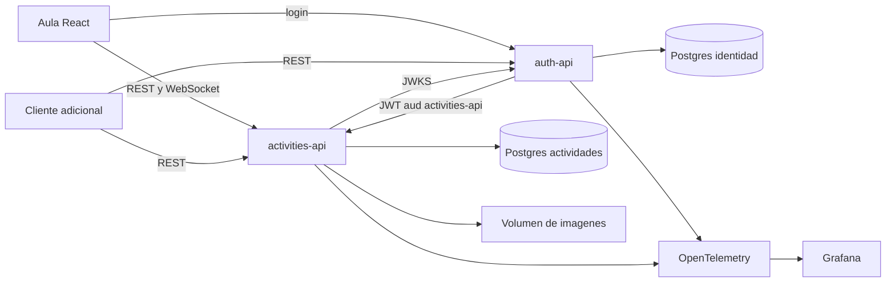
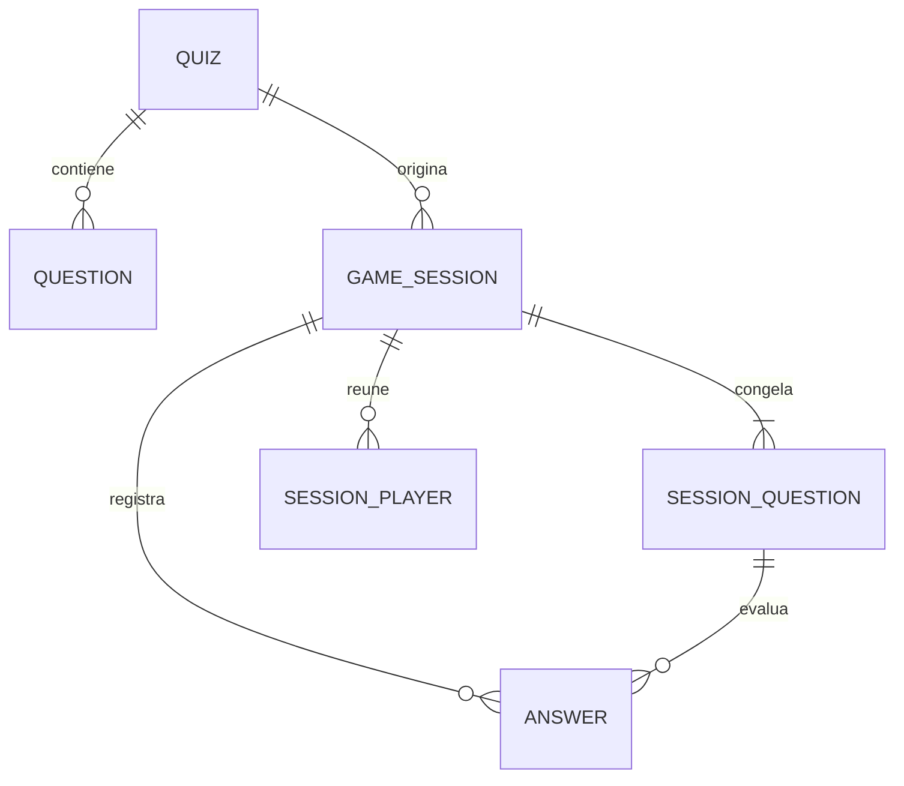
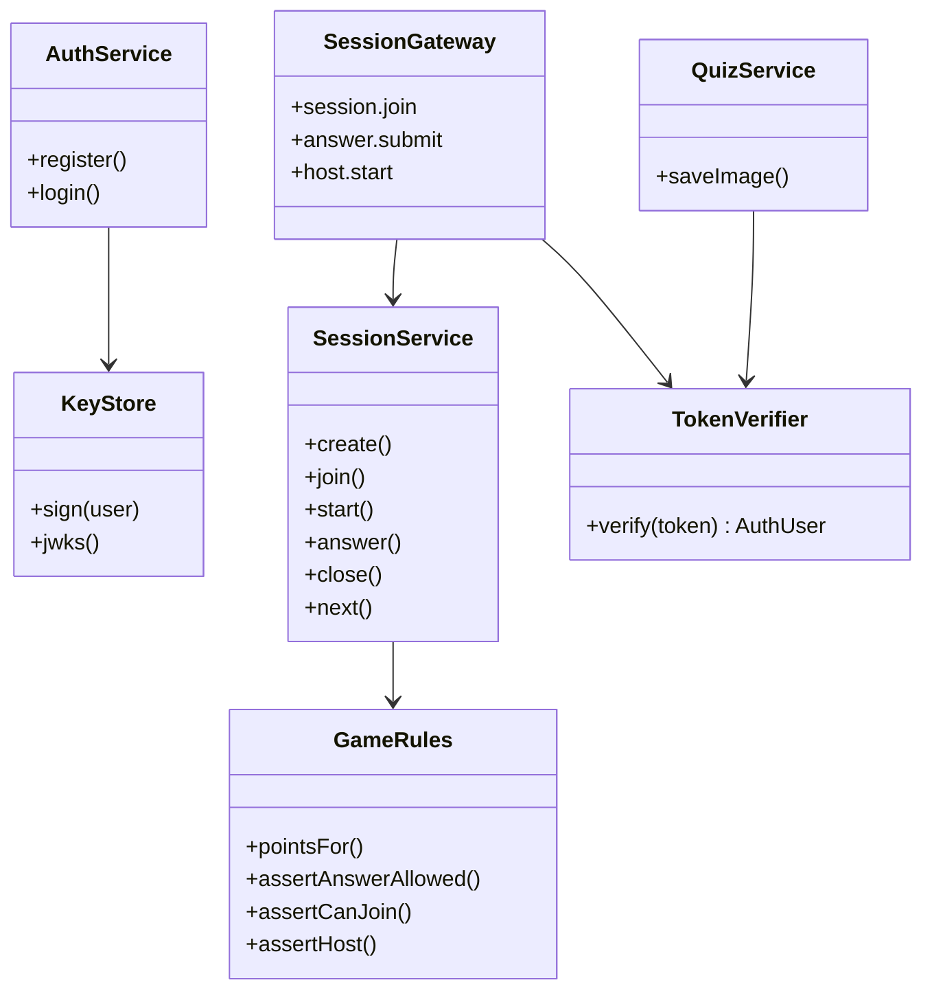

# Especificación: ProfeLink Actividades

## Alcance

Durante la clase, el profesor necesita una evaluación corta sin recargar la página. Esta solución permite registrarse, armar cuestionarios de verdadero o falso con imagen, abrir una sala con código y jugar en vivo. Al cerrar cada pregunta se revela la respuesta y se asigna un punto por acierto. Al terminar se guarda la clasificación.

Queda fuera del alcance partir el juego en más servicios, adaptar el socket a varias réplicas y exportar reportes a una cola. Esas extensiones se justifican después de que la partida y sus comprobaciones estén estables.

## Reglas

- El dueño administra sus cuestionarios y sus salas.
- Un participante no edita preguntas ni controla una partida ajena.
- La sala admite hasta 40 personas. Quien ya entró puede reconectar sin ocupar otro puesto.
- Al iniciar, el cuestionario se copia a la sesión. Editarlo después no cambia la partida en curso. Mientras la sala sigue abierta, el cuestionario queda bloqueado.
- Hay una respuesta por persona y pregunta. El reenvío no suma de nuevo.
- Una respuesta tardía, o enviada con la pregunta cerrada, se rechaza.
- Acierto: 1. Error o silencio: 0.
- La respuesta correcta no viaja al cliente mientras la pregunta acepta respuestas. El marcador visible tampoco muestra el punto de esa pregunta hasta el cierre.
- Dos salas no comparten participantes, respuestas ni puntaje.
- El canal en vivo exige el mismo JWT que la API.

## Estilo de arquitectura

Se usan dos servicios autónomos y dos clientes web.

`auth-api` solo conoce credenciales y emite un JWT RS256. La audiencia es `activities-api`. `activities-api` no consulta la base de identidad: valida la firma contra `/.well-known/jwks.json` y exige esa audiencia.

El juego, las imágenes y el puntaje viven juntos porque una respuesta y su punto son una sola transacción. Separarlos en microservicios obligaría a coordinar el cierre de la pregunta entre procesos. El costo de la decisión es operar dos APIs, dos bases y un contrato de tokens. El beneficio es que otro proyecto consume actividades por red, sin ver usuarios ni el código del juego.

Los clientes no comparten librerías con las APIs. El contrato es OpenAPI, publicado con Scalar en `/docs` y como documento en `/openapi.json`.

## Organización interna

Cada API NestJS sigue Clean Architecture.

| Lugar | Actividades |
|---|---|
| Dominio | `sessions/domain/game-rules.ts` y `present-session.ts`. Ahí se decide si la respuesta vale, si llegó tarde y qué puede ver cada persona. |
| Casos de uso | `QuizService` y `SessionService`. Abren la sala, copian el cuestionario, guardan la respuesta y publican el cambio. |
| Entrada HTTP y en vivo | `QuizController`, `SessionController` y `SessionGateway`. Los dos últimos llaman los mismos casos de uso. |
| Datos | Prisma sobre PostgreSQL, archivos en el volumen de imágenes y `TokenVerifier` para el JWT. |

La identidad repite el corte en pequeño: `KeyStore` firma, `AuthService` registra y autentica, `AuthController` expone HTTP.

## Cómo llega una pregunta y cómo no se suma dos veces

1. El anfitrión llama `POST /sessions/:code/start` o emite `host.start`.
2. El caso de uso fija `question_open`, `closesAt` y arma un temporizador en el servidor.
3. El gateway envía `session.state` solo a los sockets de esa sala. El estado de cada persona es distinto: no incluye la respuesta correcta ni la respuesta de los demás.
4. La persona responde por `POST /sessions/:code/answers` o por `answer.submit`.
5. Dentro de una transacción se bloquea la fila de la sala, se vuelven a leer el estado y la hora, y se aplican las reglas.
6. La inserción usa la unicidad `(sesión, pregunta, usuario)`. Si dos envíos llegan juntos, uno queda escrito y el otro recibe `ALREADY_ANSWERED`. El punto solo se incrementa después de insertar.
7. Al cerrar, por tiempo o por el anfitrión, el estado pasa a `question_closed` y recién ahí el cliente recibe la respuesta correcta y el marcador.

## Modelo de datos

La identidad guarda `users` en su propia base. Actividades guarda `owner_id` y `user_id` como identificadores del token, sin una llave foránea hacia la otra base.

## Diagrama de clases

## API

Identidad:

- `POST /auth/register`
- `POST /auth/login`
- `GET /auth/me`
- `GET /.well-known/jwks.json`

Actividades, todas con `Authorization: Bearer` excepto las imágenes:

- `GET|POST /quizzes` y `GET|PATCH|DELETE /quizzes/:id`
- preguntas, orden e imagen en `/quizzes/:id/questions`
- `GET /media/:archivo`
- `POST /sessions`, `GET /sessions/mine`, `GET /sessions/:code`
- `POST /sessions/:code/join|start|close|next|finish|answers`
- `GET /sessions/:code/results`
- `DELETE /sessions/:code` cancela una sala que sigue en espera

Los errores tienen `code` y `message`. Los de sala que la interfaz muestra son `ROOM_NOT_FOUND`, `NOT_HOST`, `NOT_OWNER`, `ALREADY_ANSWERED`, `TOO_LATE`, `QUESTION_CLOSED`, `ROOM_FULL` y `UNAUTHORIZED`.

## Eventos en vivo

El socket es Socket.IO sobre el mismo origen de `activities-api`, ruta `/socket.io`. El token va en `auth.token` del handshake. Sin un JWT de audiencia `activities-api`, la conexión se cierra.

El cliente emite:

| Evento | Datos |
|---|---|
| `session.watch` | `{ code }` para el anfitrión |
| `session.join` | `{ code }` para un participante |
| `answer.submit` | `{ code, questionId, value }` |
| `host.start` `host.close` `host.next` `host.finish` | `{ code }` |

El servidor emite:

| Evento | Datos |
|---|---|
| `session.state` | El mismo estado que `GET /sessions/:code`, personalizado |
| `game.error` | `{ code, message }` solo a quien provocó el error |

Al reconectar, el cliente vuelve a emitir `session.watch` o `session.join` y, si el socket no está, consulta `GET /sessions/:code`. El estado vigente sale de PostgreSQL.

## Observabilidad

Cada API arranca el SDK de OpenTelemetry y exporta trazas y métricas al collector. Prometheus lee al collector y Grafana muestra solicitudes HTTP, respuestas aceptadas o rechazadas, conexiones WebSocket y salas iniciadas.

## Despliegue

La clase usa el VPS de Hetzner Cloud llamado Proyecto-paradigmas, hostname `profelink`, en Helsinki, Ubuntu 24.04, tipo CPX22. La IPv4 es `157.180.79.235`.

| Uso | Dirección |
|---|---|
| Aula | http://157.180.79.235:8080 |
| Cliente adicional | http://157.180.79.235:8081 |
| Identidad | http://157.180.79.235:3001 |
| Actividades y WebSocket | http://157.180.79.235:3002 |

El navegador habla con esas URLs. Dentro de Docker, `activities-api` lee las llaves en `http://auth-api:3001/.well-known/jwks.json`. El detalle de `.env`, imágenes y arranque está en el README.
